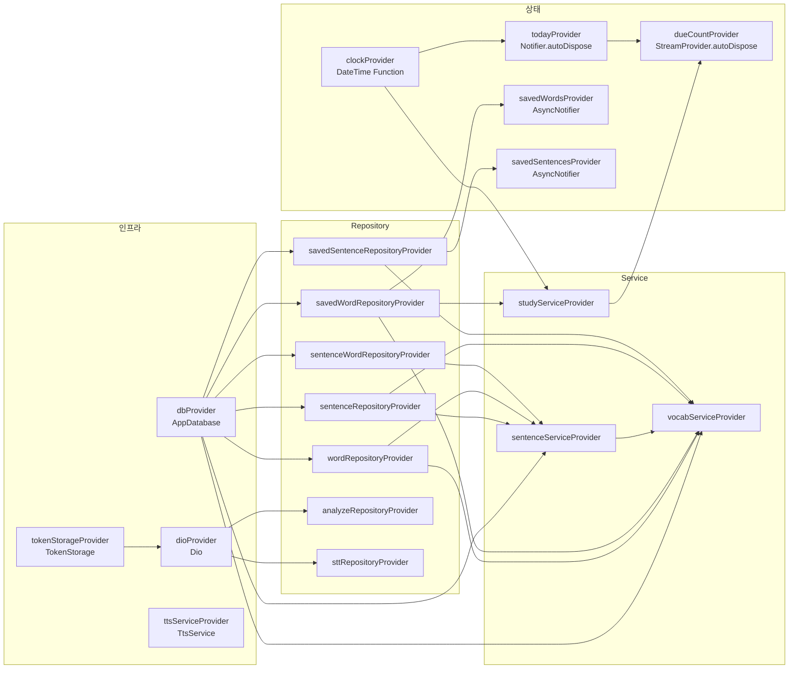

# Provider (Riverpod) 사용 방식

> 이 문서는 `lib/provider/*.dart`, `lib/main.dart`, `lib/layout/root_shell.dart`, `lib/screens/**` 코드를 직접 읽고 정리한 것입니다.
> 2026-11-19 정리 반영
> - 이름·위치: `workdRepositoryProvider` → `wordRepositoryProvider`, `sentenceWordsRepositoryProvider` → `sentenceWordRepositoryProvider`, `tts_provider.dart` → `tts_service_provider.dart`, Notifier 파일 분리, 모든 provider 타입 명시, provider 본문 의존성 `ref.watch`
> - 버그 수정: 자정이 지나도 복습 개수 기준일이 안 바뀌던 문제 → `todayProvider`/`clockProvider` 추가(`lib/provider/today_provider.dart`), `RootShell`이 앱 복귀 시 날짜 갱신
> 관련 문서: [repository.md](./repository.md) · [model.md](./model.md) · [router.md](./router.md) · [table.md](./table.md)

## 0. 버전과 시작점

- `pubspec.yaml:41` → `flutter_riverpod: ^2.6.1` (lock 파일 기준 실제 버전 `2.6.1`)
- 코드 생성(`riverpod_annotation`, `@riverpod`)은 **쓰지 않음**. 모든 provider를 손으로 `final xxxProvider = ...` 형태로 선언합니다.
- 앱 루트: `lib/main.dart:8`

```dart
runApp(const ProviderScope(child: App()));
```

`ProviderScope`가 모든 provider의 상태를 담는 컨테이너입니다. `overrides`는 사용하지 않습니다. 앱 전체에 `ProviderScope`가 하나뿐이라서, provider 인스턴스도 앱 전체에서 하나씩만 생깁니다(사실상 싱글톤).

### `lib/provider/` 파일 규칙

- **provider 선언만** 둡니다. Repository/Service 클래스 구현은 `lib/repository/`, `lib/service/` 에 있습니다.
- 파일 이름은 `<만드는 것>_provider.dart` (점은 확장자 하나만).
  - 객체를 만들어 주는 provider: `word_repository_provider.dart`, `vocab_service_provider.dart`, `tts_service_provider.dart` …
  - 화면 상태(Notifier): `saved_words_provider.dart`, `saved_sentences_provider.dart`
- 예외: `dio_provider.dart` 안의 `tokenStorageProvider`, `study_service_provider.dart` 안의 `dueCountProvider`, `today_provider.dart` 안의 `clockProvider` 는 짝이 되는 provider와 같은 파일에 둡니다.

---

## 1. Riverpod 기초를 이 프로젝트 코드로 보기

이 프로젝트에서 실제로 쓰는 provider 종류는 아래 네 가지뿐입니다. (`FutureProvider`, `StateProvider`, `StateNotifierProvider`, `.family`는 쓰지 않습니다.)

### 1-1. `Provider<T>`: 객체 하나를 만들어서 나눠 주기

값이 바뀌지 않는 객체(DB, Dio, Repository, Service)를 만들 때 씁니다. 처음 누가 읽을 때 한 번 만들어지고, 그 뒤로는 같은 인스턴스를 돌려줍니다.

```dart
// lib/provider/db_provider.dart:4
final dbProvider = Provider<AppDatabase>((ref) {
  return AppDatabase();
});

// lib/provider/word_repository_provider.dart:5
final wordRepositoryProvider = Provider<WordRepository>((ref) {
  return WordRepository(database: ref.watch(dbProvider));   // 다른 provider를 받아서 주입
});
```

provider 본문의 `ref`로 다른 provider를 꺼내 생성자에 넣어 줍니다. 이 프로젝트에서는 이 방식이 **의존성 주입(DI) 역할**을 합니다.

### 1-2. `StreamProvider.autoDispose<T>`: Stream을 구독해서 화면에 계속 반영하기

```dart
// lib/provider/study_service_provider.dart:14
final dueCountProvider = StreamProvider.autoDispose<int>((ref) {
  final today = ref.watch(todayProvider);                 // 날짜가 바뀌면 provider가 다시 만들어짐
  return ref.watch(studyServiceProvider).watchDueCount(today);
});
```

`watchDueCount(day)`는 drift의 `watchSingle()` 스트림입니다(`lib/repository/saved_word_repository.dart:62-68`). DB의 해당 테이블이 바뀌면 새 값이 자동으로 들어오고, 이 provider를 `watch`하는 위젯도 자동으로 다시 그려집니다. 값은 `AsyncValue<int>`로 감싸져 있으며, 화면에서는 `.valueOrNull ?? 0`으로 꺼내 씁니다.

drift `watch`는 **테이블이 바뀔 때만** 다시 실행되고, 기준 시각("그날 23:59:59.999")은 구독할 때 쿼리 파라미터로 고정됩니다. 그래서 날짜가 바뀌면 새 기준으로 다시 구독해야 하고, 그 신호가 아래 `todayProvider`입니다. 다시 구독하는 동안 Riverpod이 이전 값을 유지하므로 배지가 깜빡이지 않습니다.

### 1-2-1. `NotifierProvider.autoDispose<N, T>`: 시간에 따라 바뀌는 값 (`todayProvider`)

```dart
// lib/provider/today_provider.dart
final clockProvider = Provider<DateTime Function()>((ref) => DateTime.now);   // :6 테스트에서 override

final todayProvider = NotifierProvider.autoDispose<TodayNotifier, DateTime>(  // :12
  TodayNotifier.new,
);
```

- `TodayNotifier.build()`(:21): 오늘 0시를 state로 두고, 다음 자정까지 `Timer`를 겁니다. 타이머는 `ref.onDispose`에서 취소합니다.
- `refresh()`(:30): 지금 날짜를 다시 보고 **바뀌었을 때만** state를 갱신한 뒤 타이머를 다시 겁니다. 기기 시간을 되돌려 타이머가 일찍 울려도 날짜는 그대로 두고 다시 기다립니다.
- 앱이 백그라운드에 있으면 타이머가 멈추거나 늦게 울릴 수 있어서, `RootShell`이 `AppLifecycleListener(onResume: ...)`로 foreground 복귀 때마다 `refresh()`를 부릅니다(`lib/layout/root_shell.dart:25-27`). 기기 시간을 바꾸려면 설정 앱으로 나가야 하므로 그 경우도 복귀 때 잡힙니다.
- `studyServiceProvider`도 `now: ref.watch(clockProvider)`로 같은 시계를 씁니다. 테스트는 `clockProvider`를 override해 시간을 조작합니다(`test/due_count_test.dart`).

### 1-3. `AsyncNotifierProvider<N, T>`: 비동기로 불러온 목록 + 수정 메서드

```dart
// lib/provider/saved_words_provider.dart:5-26
class SavedWordsNotifier extends AsyncNotifier<List<Word>> {
  @override
  Future<List<Word>> build() {                       // 첫 로드(그리고 invalidate 뒤 다시 로드)
    return ref.watch(savedWordRepositoryProvider).findAllWords();
  }

  Future<void> remove(int wordId) async {            // 낙관적 삭제
    final previous = state.valueOrNull ?? const [];
    state = AsyncData(previous.where((w) => w.id != wordId).toList());
    try {
      await ref.read(savedWordRepositoryProvider).deleteByWordId(wordId);
    } catch (_) {
      state = AsyncData(previous);                   // 실패하면 되돌림
      rethrow;
    }
  }
}

final savedWordsProvider =
    AsyncNotifierProvider<SavedWordsNotifier, List<Word>>(SavedWordsNotifier.new);
```

`savedSentencesProvider`(`lib/provider/saved_sentences_provider.dart`)도 `List<Sentence>`를 다룬다는 점만 다르고 구조는 같습니다.

- 상태 읽기: `ref.watch(savedWordsProvider)` → `AsyncValue<List<Word>>`
- 메서드 호출: `ref.read(savedWordsProvider.notifier).remove(id)`

### 1-4. `ref.watch` vs `ref.read`: 이 프로젝트의 규칙

| 쓰는 곳 | 사용 | 의미 |
|---|---|---|
| 위젯 `build()` 안 | `ref.watch(...)` | 값이 바뀌면 위젯을 다시 그림 |
| 버튼 콜백, `async` 메서드 안 | `ref.read(...)` | 지금 값을 한 번만 가져옴, 구독하지 않음 |
| **provider 본문 / Notifier `build()` 안** | `ref.watch(...)` | 의존 provider가 다시 만들어지면 이 provider도 다시 만들어짐 (Riverpod 공식 권장) |
| Notifier 메서드(`remove` 등) 안 | `ref.read(...)` | 콜백과 같은 취급 |

지금 의존 대상(DB, Dio, Repository)은 앱 수명 동안 다시 만들어지지 않으므로 `read`→`watch` 변경으로 실제 동작이 달라지지는 않습니다. 나중에 어떤 provider를 invalidate/override 하게 되더라도 의존하는 쪽이 옛 인스턴스를 붙잡지 않도록 하는 규칙입니다.

### 1-5. `ConsumerWidget` / `ConsumerStatefulWidget`

- `ConsumerWidget`: `build(BuildContext context, WidgetRef ref)`처럼 `build`에서 `ref`를 받습니다. 예: `SentenceDetailScreen`(`lib/screens/analyze/sentence_detail_screen.dart:15`)
- `ConsumerStatefulWidget` + `ConsumerState`: `State` 안 어디서든 `ref`를 쓸 수 있습니다(`initState`, async 메서드 등). 예: `RootShell`, `SplashScreen`, `StudyScreen`, `VocabScreen`, `AnalyzeHomeScreen`, `PronunciationScreen`

이 프로젝트에서는 **화면 상태(로딩 플래그, 입력값, 녹음 상태 등)는 `setState`로**, **DB/서버 데이터 접근은 provider로** 나눠서 처리합니다.

---

## 2. Provider 의존 그래프



화면 쪽 연결(텍스트):

```
RootShell ............ watch dueCountProvider / 앱 복귀 시 read todayProvider.notifier.refresh()
AnalyzeHomeScreen .... read analyzeRepositoryProvider / _DueCard: watch dueCountProvider
SentenceDetailScreen . read vocabServiceProvider(저장 중 버튼 비활성화), ttsServiceProvider / invalidate savedWords·savedSentences
VocabScreen .......... watch savedWords·savedSentences / read .notifier, sentenceServiceProvider, ttsServiceProvider
StudyScreen .......... read studyServiceProvider, ttsServiceProvider / watch dueCountProvider, savedWordsProvider
PronunciationScreen .. read sttRepositoryProvider, ttsServiceProvider
SplashScreen ......... read dbProvider (DB 미리 열기)
```

정리하면 흐름은 `db / dio / tts → repository → service → 화면`입니다. 화면이 repository를 바로 부르는 곳은 **API repository 두 개**(`analyzeRepositoryProvider`, `sttRepositoryProvider`)와 Splash의 `dbProvider` warm-up뿐입니다. DB repository는 화면에서 직접 부르지 않습니다. Repository/Service 클래스 내부는 [repository.md](./repository.md), DB 테이블은 [table.md](./table.md)를 보세요.

---

## 3. Provider 목록

| 이름 | 종류 | 정의 위치 | 만드는 것 | 의존 provider | 사용하는 곳 |
|---|---|---|---|---|---|
| `dbProvider` | `Provider<AppDatabase>` | `lib/provider/db_provider.dart:4` | drift `AppDatabase()` | 없음 | 모든 DB repository/service provider, `lib/screens/splash/splash_screen.dart:51` |
| `tokenStorageProvider` | `Provider<TokenStorage>` | `lib/provider/dio_provider.dart:7` | `TokenStorage()` | 없음 | `dioProvider`만 사용(`dio_provider.dart:22`) |
| `dioProvider` | `Provider<Dio>` | `lib/provider/dio_provider.dart:16` | `Environment.baseUrl` 기준 Dio + `AuthInterceptor`(+ 로그) | `tokenStorageProvider` | `analyzeRepositoryProvider`, `sttRepositoryProvider` |
| `ttsServiceProvider` | `Provider<TtsService>` | `lib/provider/tts_service_provider.dart:4` | `TtsService`(`lib/service/tts_service.dart`, flutter_tts, zh-CN), `ref.onDispose`로 stop | 없음 | `study_screen.dart:330`, `vocab_screen.dart:162`, `pronunciation_screen.dart:54`, `pronunciation_screen.dart:196`, `sentence_detail_screen.dart:83`, `sentence_detail_screen.dart:273` |
| `wordRepositoryProvider` | `Provider<WordRepository>` | `lib/provider/word_repository_provider.dart:5` | `WordRepository` | `dbProvider` | `sentenceServiceProvider`, `vocabServiceProvider` |
| `sentenceRepositoryProvider` | `Provider<SentenceRepository>` | `lib/provider/sentence_repository_provider.dart:5` | `SentenceRepository` | `dbProvider` | `sentenceServiceProvider`, `vocabServiceProvider` |
| `sentenceWordRepositoryProvider` | `Provider<SentenceWordRepository>` | `lib/provider/sentence_word_repository_provider.dart:5` | `SentenceWordRepository` | `dbProvider` | `sentenceServiceProvider` |
| `savedWordRepositoryProvider` | `Provider<SavedWordRepository>` | `lib/provider/saved_word_repository_provider.dart:5` | `SavedWordRepository` | `dbProvider` | `savedWordsProvider`, `studyServiceProvider`, `vocabServiceProvider` |
| `savedSentenceRepositoryProvider` | `Provider<SavedSentenceRepository>` | `lib/provider/saved_sentence_repository_provider.dart:5` | `SavedSentenceRepository` | `dbProvider` | `savedSentencesProvider`, `vocabServiceProvider` |
| `analyzeRepositoryProvider` | `Provider<AnalyzeRepository>` | `lib/provider/analyze_repository_provider.dart:5` | `AnalyzeRepository`(`lib/repository/analyze_repository.dart`, `POST /analyze/sentence`) | `dioProvider` | `lib/screens/analyze/analyze_home_screen.dart:42` |
| `sttRepositoryProvider` | `Provider<SttRepository>` | `lib/provider/stt_repository_provider.dart:5` | `SttRepository`(`lib/repository/stt_repository.dart`, `POST /stt/transcribe` multipart) | `dioProvider` | `lib/screens/practice/pronunciation_screen.dart:116` |
| `sentenceServiceProvider` | `Provider<SentenceService>` | `lib/provider/sentence_service_provider.dart:8` | `SentenceService` | `dbProvider`, `sentenceRepositoryProvider`, `wordRepositoryProvider`, `sentenceWordRepositoryProvider` | `vocabServiceProvider`, `lib/screens/vocab/vocab_screen.dart:225` (`loadAnalysis`) |
| `vocabServiceProvider` | `Provider<VocabService>` | `lib/provider/vocab_service_provider.dart:10` | `VocabService` | `dbProvider`, `wordRepositoryProvider`, `savedWordRepositoryProvider`, `sentenceServiceProvider`, `sentenceRepositoryProvider`, `savedSentenceRepositoryProvider` | `lib/screens/analyze/sentence_detail_screen.dart:202`(문장), `sentence_detail_screen.dart:238`(단어) |
| `clockProvider` | `Provider<DateTime Function()>` | `lib/provider/today_provider.dart:6` | 현재 시각 함수(`DateTime.now`). 테스트에서 override | 없음 | `todayProvider`, `studyServiceProvider` |
| `todayProvider` | `NotifierProvider.autoDispose<TodayNotifier, DateTime>` | `lib/provider/today_provider.dart:12` (Notifier `:16`) | 오늘 날짜(0시). 자정 타이머 + `refresh()` | `clockProvider` | `dueCountProvider` / notifier: `lib/layout/root_shell.dart:26` |
| `studyServiceProvider` | `Provider<StudyService>` | `lib/provider/study_service_provider.dart:6` | `StudyService` | `savedWordRepositoryProvider`, `clockProvider` | `dueCountProvider`, `lib/screens/study/study_screen.dart:28`, `study_screen.dart:48` |
| `dueCountProvider` | `StreamProvider.autoDispose<int>` | `lib/provider/study_service_provider.dart:14` | 오늘 복습할 단어 수 스트림 | `todayProvider`, `studyServiceProvider` | `lib/layout/root_shell.dart:66`(탭 배지), `lib/screens/analyze/analyze_home_screen.dart:180`, `lib/screens/study/study_screen.dart:103` |
| `savedWordsProvider` | `AsyncNotifierProvider<SavedWordsNotifier, List<Word>>` | `lib/provider/saved_words_provider.dart:23` (Notifier `:5`) | 저장한 단어 목록 + `remove()` | `savedWordRepositoryProvider` | watch: `vocab_screen.dart:132`, `study_screen.dart:105` / notifier: `vocab_screen.dart:171` / invalidate: `vocab_screen.dart:146`, `sentence_detail_screen.dart:239` |
| `savedSentencesProvider` | `AsyncNotifierProvider<SavedSentencesNotifier, List<Sentence>>` | `lib/provider/saved_sentences_provider.dart:25` (Notifier `:5`) | 저장한 문장 목록 + `remove()` | `savedSentenceRepositoryProvider` | watch: `vocab_screen.dart:199` / notifier: `vocab_screen.dart:238` / invalidate: `vocab_screen.dart:213`, `sentence_detail_screen.dart:204` |

> 화면 경로는 모두 `lib/screens/<폴더>/` 아래에 있습니다(`analyze/`, `study/`, `vocab/`, `practice/`, `splash/`).

### 화면별 Consumer 종류

| 위젯 | 종류 | 위치 | 비고 |
|---|---|---|---|
| `RootShell` | ConsumerStatefulWidget | `lib/layout/root_shell.dart:9` | `StatefulShellRoute.indexedStack`의 셸이라 항상 화면에 있음([router.md](./router.md)). `AppLifecycleListener`를 가지려고 Stateful |
| `SplashScreen` | ConsumerStatefulWidget | `lib/screens/splash/splash_screen.dart:11` | |
| `AnalyzeHomeScreen` | ConsumerStatefulWidget | `lib/screens/analyze/analyze_home_screen.dart:13` | 분석 결과는 `setState`로 보관 |
| `_DueCard` | ConsumerWidget | `lib/screens/analyze/analyze_home_screen.dart:175` | |
| `SentenceDetailScreen` | ConsumerWidget | `lib/screens/analyze/sentence_detail_screen.dart:15` | |
| `_SaveSentenceButton` | ConsumerStatefulWidget | `lib/screens/analyze/sentence_detail_screen.dart:185` | 저장 중 `_saving`이면 버튼 비활성화(연타 방지) |
| `_WordRow` | ConsumerStatefulWidget | `lib/screens/analyze/sentence_detail_screen.dart:166` | 저장됨 표시 `_saved`, 저장 중 `_saving`은 로컬 state |
| `VocabScreen` | ConsumerStatefulWidget | `lib/screens/vocab/vocab_screen.dart:16` | `ref`를 직접 쓰지 않음(탭 상태만 가짐) |
| `_SavedWordList` / `_SavedSentenceList` | ConsumerWidget | `vocab_screen.dart:127` / `:194` | |
| `StudyScreen` | ConsumerStatefulWidget | `lib/screens/study/study_screen.dart:13` | 세션 객체는 `setState`로 보관 |
| `_StartView` / `_CardView` / `_CardFace` | ConsumerWidget | `study_screen.dart:96` / `:136` / `:256` | `_CardView`는 `ref`를 쓰지 않음 |
| `PronunciationScreen` | ConsumerStatefulWidget | `lib/screens/practice/pronunciation_screen.dart:15` | |

---

## 4. 화면에서 상태를 갱신하는 방법

이 프로젝트에서는 아래 네 가지 방식을 씁니다.

**① Stream으로 자동 갱신: `dueCountProvider`**
drift의 `watchSingle()`이 DB 변경을 감지합니다. 단어를 저장(`vocabService.saveWord`), 삭제(`SavedWordsNotifier.remove`)하거나 학습 결과를 기록(`studyService.record`)하면, 따로 invalidate하지 않아도 배지와 카드의 숫자가 바뀝니다.

**② 당겨서 새로고침: `RefreshIndicator` + `ref.invalidate`**
```dart
// vocab_screen.dart:146 / :213
onRefresh: () async => ref.invalidate(savedWordsProvider),
```
invalidate하면 Notifier의 `build()`가 다시 실행되고, `watch` 중인 리스트가 다시 그려집니다.

**③ 다른 화면에서 저장한 뒤 invalidate**
```dart
// sentence_detail_screen.dart:235-253 (_WordRowState._save)
setState(() => _saving = true);              // 저장 중 버튼 비활성화
try {
  final added = await ref.read(vocabServiceProvider).saveWord(widget.word);
  if (added) ref.invalidate(savedWordsProvider);
  ...                                         // 성공/중복 스낵바, _saved = true
} catch (e, st) {
  ...                                         // debugPrint + friendlySaveErrorMessage 스낵바
} finally {
  if (mounted) setState(() => _saving = false);
}
```
문장 저장(`_SaveSentenceButtonState._save`, `:198`)도 같은 방식으로 `savedSentencesProvider`를 invalidate합니다. 단어장 탭을 열지 않은 상태라도 다음에 열 때 새 목록이 보입니다.

**④ Notifier 메서드로 낙관적 업데이트: `remove()`**
`ref.read(savedWordsProvider.notifier).remove(w.id)`(`vocab_screen.dart:171`)는 state에서 항목을 먼저 지우고 DB를 삭제합니다. 실패하면 원래 상태로 되돌린 뒤 `rethrow`하고, 화면은 이를 `catch`해서 "삭제 실패 — 복구했어요." 스낵바를 띄웁니다.

**provider를 쓰지 않는 갱신**: 분석 결과(`AnalyzeHomeScreen._analyzeResult`), 학습 세션(`StudyScreen._session`), 발음 결과(`PronunciationScreen._result`)는 provider가 아니라 `setState`로 관리합니다.

---

## 5. 헷갈릴 만한 부분

### 정리됨 (2026-11-19)
- ~~파일 이름 규칙 혼재~~: `sentence_words_repository.provider.dart` → `sentence_word_repository_provider.dart`, `tts_provider.dart` → `tts_service_provider.dart`. 목록 상태 Notifier는 `saved_words_provider.dart` / `saved_sentences_provider.dart` 로 분리.
- ~~변수 이름 오타 `workdRepositoryProvider`~~ → `wordRepositoryProvider`.
- ~~클래스가 provider 파일 안에 있음~~: `AnalyzeRepository`, `SttRepository` → `lib/repository/`, `TtsService` → `lib/service/tts_service.dart`.
- ~~타입을 생략한 provider~~ → 전부 `Provider<T>` 명시.
- ~~provider 본문에서 `ref.read`만 사용~~ → 본문과 Notifier `build()` 는 `ref.watch`.
- ~~화면이 DB repository 직접 호출~~(`vocab_screen` → `sentenceWordsRepositoryProvider`) → `sentenceServiceProvider.loadAnalysis`.
- ~~`dueCountProvider` 기준일이 자정에 안 바뀜~~ → `todayProvider`(자정 타이머 + 앱 복귀 시 `refresh`)를 watch.
- ~~"`record()`가 `savedWordsProvider`를 invalidate하지 않음"~~ → 문제가 아니었음. `savedWordsProvider`는 `words` 행만 들고 있고 SRS 필드가 없어 화면에 옛 값이 보일 일이 없음.

### 남아 있는 것 (메모만)
1. **생명주기와 dispose**
   - `autoDispose`를 쓰는 provider는 `dueCountProvider`, `todayProvider` 둘입니다. 나머지는 모두 앱이 끝날 때까지 살아 있습니다.
   - 둘 다 autoDispose지만, `RootShell`(항상 마운트된 셸)이 계속 `watch`하므로 실제로는 거의 해제되지 않습니다.
   - `ref.onDispose`를 등록한 provider는 `ttsServiceProvider`(`tts_service_provider.dart:6`)와 `todayProvider`(타이머 취소)뿐입니다. `dbProvider`에는 `db.close()`가, `dioProvider`에는 `dio.close()`가 등록되어 있지 않습니다.
   - 앱을 foreground에 둔 채 기기 시간을 바꾸면, 다음 타이머가 울리거나 다음 앱 복귀 때까지 복습 기준일 반영이 늦을 수 있습니다.
2. **`RefreshIndicator`가 곧바로 끝남**: `onRefresh: () async => ref.invalidate(...)`는 다시 로드되기를 기다리지 않으므로 스피너가 바로 사라집니다. (Riverpod 2.x에서 기다리려면 보통 `ref.refresh(provider.future)`를 씁니다.)
3. **화면이 API repository를 직접 호출**: `analyze_home_screen.dart:42`, `pronunciation_screen.dart:116`. 호출 한 번 + 모델 변환뿐이라 service를 두지 않았습니다.
4. **`ref`를 쓰지 않는 Consumer**: `VocabScreen`, `_CardView`는 Consumer 계열이지만 `ref`를 사용하지 않습니다.

---

## 6. 새 provider를 추가할 때

**A. DB repository 추가**: `word_repository_provider.dart` 패턴
```dart
// lib/provider/foo_repository_provider.dart
import 'package:flutter_riverpod/flutter_riverpod.dart';
import 'package:pass_kuai/provider/db_provider.dart';
import 'package:pass_kuai/repository/foo_repository.dart';

final fooRepositoryProvider = Provider<FooRepository>((ref) {
  return FooRepository(database: ref.watch(dbProvider));
});
```

**B. 서버 API repository 추가**: `analyze_repository_provider.dart` 패턴. 클래스는 `lib/repository/foo_repository.dart` 에 두고 provider 파일에는 선언만.
```dart
final fooRepositoryProvider = Provider<FooRepository>((ref) {
  return FooRepository(dio: ref.watch(dioProvider));
});
```

**C. service 추가**: `vocab_service_provider.dart` 패턴. 필요한 repository provider를 모두 `ref.watch`로 받아 생성자에 넣습니다.

**D. 화면에 보여 줄 목록 + 수정 메서드**: `saved_words_provider.dart` 패턴
1. `lib/provider/<복수형>_provider.dart` 에 `AsyncNotifier<List<T>>`를 상속하고, `build()`에서 `ref.watch(repo)`로 목록을 불러옵니다.
2. 수정 메서드는 `ref.read(repo)`를 쓰고, 낙관적으로 state를 바꾼 뒤 실패하면 되돌리고 `rethrow`합니다.
3. `AsyncNotifierProvider<N, List<T>>(N.new)`로 노출합니다.
4. 화면은 `ref.watch(...).when(loading:, error:, data:)`로 그리고, 다른 곳에서 데이터를 바꾸면 `ref.invalidate(...)`를 호출합니다.

**E. DB 변경을 실시간으로 반영할 값**: `dueCountProvider` 패턴
repository에 drift `watch()`/`watchSingle()` 스트림을 만들고, `StreamProvider.autoDispose`로 감싼 뒤 화면에서 `ref.watch(...).valueOrNull`로 씁니다.

**F. 해제가 필요한 객체**: `ttsServiceProvider` 패턴. `ref.onDispose(service.dispose)`를 등록합니다.

**G. 시간에 따라 바뀌는 값**: `todayProvider` 패턴. `Notifier`가 타이머로 스스로 갱신하고(`ref.onDispose`로 타이머 취소), 지금 시각은 `clockProvider`에서 읽어 테스트에서 바꿔 끼울 수 있게 합니다. 백그라운드에서는 타이머를 믿을 수 없으니 앱 복귀(`AppLifecycleListener.onResume`) 때도 갱신합니다.
