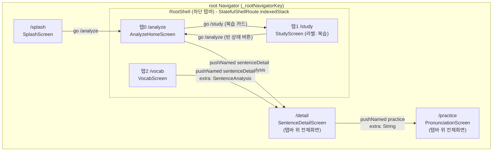

# 라우팅 (go_router)

이 문서는 pass_kuai 앱이 **go_router**로 화면을 어떻게 연결하는지 설명합니다. go_router를 처음 보는 사람이 이 프로젝트 코드를 읽고 이해할 수 있도록 썼습니다. 모든 내용은 실제 코드를 읽고 확인한 것이고, 줄번호는 작성 시점 기준입니다.

> 2026-11-19 정리 반영: `router.dart`/`main.dart`의 상대 경로 import를 `package:pass_kuai/...` 형식으로 통일(줄번호 1줄씩 당겨짐), 단어장 → 문장 상세 이동은 `sentenceService.loadAnalysis` 사용. `RootShell`은 앱 복귀 시 복습 기준일을 갱신하려고 `ConsumerStatefulWidget`이 되었습니다(`AppLifecycleListener`, [provider.md](./provider.md) `todayProvider`).

- 패키지: `go_router: ^17.3.0` (`pubspec.yaml:37`), lock 버전 `17.3.0` (`pubspec.lock`)
- 관련 파일
  - `lib/router/router.dart`: 경로 상수와 라우터 정의
  - `lib/layout/root_shell.dart`: 하단 탭바가 있는 껍데기(Shell) 화면
  - `lib/main.dart`: `MaterialApp.router`에 라우터 연결

관련 문서:
- 데이터 저장/조회: [repository.md](./repository.md)
- 화면 사이에 넘기는 데이터 모델(`SentenceAnalysis` 등): [model.md](./model.md)
- Riverpod 상태(`dueCountProvider` 등): [provider.md](./provider.md)
- DB 테이블: [table.md](./table.md)

---

## 1. 큰 그림

```
main.dart
  └─ ProviderScope
       └─ App → MaterialApp.router(routerConfig: router)   ← router.dart의 전역 변수
                    │
                    ▼
               GoRouter (root navigator: _rootNavigatorKey)
                 ├─ /splash          SplashScreen           (전체화면)
                 ├─ StatefulShellRoute.indexedStack → RootShell(하단 탭바)
                 │    ├─ Branch 0 (_analyzeNavigatorKey)  /analyze  AnalyzeHomeScreen
                 │    ├─ Branch 1 (_studyNavigatorKey)    /study    StudyScreen
                 │    └─ Branch 2 (_vocabNavigatorKey)    /vocab    VocabScreen
                 ├─ /detail          SentenceDetailScreen   (전체화면, 탭바 위에 뜸)
                 └─ /practice        PronunciationScreen    (전체화면, 탭바 위에 뜸)
```

`main.dart:16-21`에서 `MaterialApp`이 아니라 `MaterialApp.router`를 쓰고, `routerConfig: router`로 `router.dart:37`의 `router` 객체를 넘깁니다. 이렇게 하면 화면 이동을 Flutter의 `Navigator.push(MaterialPageRoute(...))` 대신 go_router가 **URL 같은 경로 문자열**로 관리합니다.

---

## 2. 기초 개념 (이 프로젝트 코드로)

### 2.1 GoRoute: "경로 하나 = 화면 하나"

```dart
// lib/router/router.dart:42-47
GoRoute(
  path: RoutePaths.splash,      // '/splash'
  name: RouteNames.splash,      // 'splash'
  parentNavigatorKey: _rootNavigatorKey,
  builder: (context, state) => const SplashScreen(),
),
```

- `path`: 이 화면의 주소. `context.go('/splash')`처럼 이 문자열로 이동합니다.
- `name`: 주소 대신 쓸 수 있는 별명. `context.goNamed('splash')`처럼 씁니다.
- `builder`: 이 경로에 왔을 때 그릴 위젯. `state`(`GoRouterState`)에는 현재 경로 정보와 `extra`(넘겨받은 데이터)가 들어 있습니다.

### 2.2 initialLocation: 앱을 켜면 처음 가는 곳

```dart
// lib/router/router.dart:39
initialLocation: RoutePaths.splash,
```

앱이 시작되면 `/splash`로 갑니다. `SplashScreen`은 DB를 미리 열어보고 최소 1.6초를 기다린 뒤 `context.go(RoutePaths.analyze)`로 분석 탭으로 넘어갑니다 (`lib/screens/splash/splash_screen.dart:40-46`).

`/` 경로는 정의돼 있지 않습니다. 시작 위치는 `initialLocation`이 정합니다.

### 2.3 Navigator와 navigatorKey

Flutter에서 "화면 스택"(뒤로 가기를 하면 하나씩 빠지는 목록)을 관리하는 위젯이 `Navigator`입니다. 이 프로젝트에는 Navigator가 **4개** 있습니다.

| 키 | 위치 | 역할 |
|---|---|---|
| `_rootNavigatorKey` (`router.dart:31`) | `GoRouter(navigatorKey: ...)` (`router.dart:37`) | 앱 전체를 덮는 최상위 스택. splash, 탭 껍데기(RootShell), 문장 상세, 발음 연습이 여기에 쌓임 |
| `_analyzeNavigatorKey` (`router.dart:33`) | 분석 Branch (`router.dart:54`) | 분석 탭 안쪽 스택 |
| `_studyNavigatorKey` (`router.dart:34`) | 복습 Branch (`router.dart:64`) | 복습 탭 안쪽 스택 |
| `_vocabNavigatorKey` (`router.dart:35`) | 단어장 Branch (`router.dart:74`) | 단어장 탭 안쪽 스택 |

`GlobalKey<NavigatorState>`는 "이 Navigator를 가리키는 손잡이"입니다. 라우트를 정의할 때 이 키로 "이 화면은 어느 스택에 쌓아라"를 지정합니다.

탭마다 Navigator가 따로 있기 때문에, 탭 A에서 화면을 몇 단계 들어간 뒤 탭 B로 갔다 와도 탭 A의 스택이 그대로 남아 있습니다.

### 2.4 StatefulShellRoute.indexedStack: 하단 탭

```dart
// lib/router/router.dart:49-84
StatefulShellRoute.indexedStack(
  builder: (context, state, navigationShell) =>
      RootShell(navigationShell: navigationShell),
  branches: [
    StatefulShellBranch(navigatorKey: _analyzeNavigatorKey, routes: [GoRoute(path: '/analyze', ...)]),
    StatefulShellBranch(navigatorKey: _studyNavigatorKey,   routes: [GoRoute(path: '/study', ...)]),
    StatefulShellBranch(navigatorKey: _vocabNavigatorKey,   routes: [GoRoute(path: '/vocab', ...)]),
  ],
),
```

- **Shell(껍데기)**: 여러 화면이 공유하는 바깥 틀. 여기서는 하단 탭바가 있는 `RootShell`입니다.
- **StatefulShellBranch**: 탭 하나. 각 Branch는 자기 Navigator(키)와 자기 라우트 목록을 가집니다. `branches` 리스트의 **순서가 곧 탭 인덱스**입니다 (0=분석, 1=복습, 2=단어장).
- **Stateful**: 탭을 바꿔도 각 탭의 상태(스크롤 위치, 입력값, 내부 스택)가 유지된다는 뜻입니다.
- **`.indexedStack`**: 내부적으로 Flutter의 `IndexedStack`을 써서 모든 탭을 메모리에 올려두고 현재 탭만 보여줍니다. 그래서 탭을 오가도 위젯이 다시 만들어지지 않습니다.
- `builder`가 받는 `navigationShell`(`StatefulNavigationShell`)은 "현재 탭의 화면 + 탭 전환 기능"이 들어 있는 위젯입니다. `RootShell`은 이걸 `Scaffold(body: navigationShell)`에 넣고 아래에 탭바를 붙입니다 (`root_shell.dart:68-69`).

### 2.5 parentNavigatorKey: "이 화면을 어느 스택에 올릴까"

```dart
// lib/router/router.dart:86-91
GoRoute(
  path: RoutePaths.sentenceDetail,   // '/detail'
  name: RouteNames.sentenceDetail,
  parentNavigatorKey: _rootNavigatorKey,
  builder: (context, state) => SentenceDetailScreen(sentence: state.extra),
),
```

`parentNavigatorKey: _rootNavigatorKey`는 "이 화면은 탭 안쪽 스택이 아니라 **최상위 스택**에 올려라"는 뜻입니다. 최상위 스택은 `RootShell` 위에 있으므로, 문장 상세 화면이 뜨면 **하단 탭바까지 가리는 전체화면**이 됩니다.

반대로 어떤 화면을 탭 Branch의 `routes` 안에(예: `/analyze`의 하위 라우트로) 넣고 `parentNavigatorKey`를 생략하면, 그 화면은 탭 안쪽 Navigator에 쌓여서 **탭바가 보이는 상태로** 열립니다. 이 프로젝트에는 현재 그런 화면이 없습니다.

참고: `/splash`, `/detail`, `/practice`는 Shell 바깥의 최상위 `routes`에 있으므로 원래도 root Navigator에 쌓입니다. 즉 이 세 곳의 `parentNavigatorKey: _rootNavigatorKey`는 동작상 생략해도 같습니다. 의도를 명시하는 표시라고 보면 됩니다. 이 키가 꼭 필요한 경우는 Branch 안에 중첩된 라우트를 전체화면으로 띄우고 싶을 때입니다.

---

## 3. 화면 지도

### 3.1 경로 / 이름 / 화면 표

| 경로 (`RoutePaths`) | 이름 (`RouteNames`) | 화면 위젯 | 파일 | 쌓이는 곳 | `extra` |
|---|---|---|---|---|---|
| `/splash` | `splash` | `SplashScreen` | `lib/screens/splash/splash_screen.dart` | root (전체화면) | 없음 |
| `/analyze` | `analyze` | `AnalyzeHomeScreen` | `lib/screens/analyze/analyze_home_screen.dart` | 탭 0 (분석) | 없음 |
| `/study` | `study` | `StudyScreen` | `lib/screens/study/study_screen.dart` | 탭 1 (복습) | 없음 |
| `/vocab` | `vocab` | `VocabScreen` | `lib/screens/vocab/vocab_screen.dart` | 탭 2 (단어장) | 없음 |
| `/detail` | `sentenceDetail` | `SentenceDetailScreen` | `lib/screens/analyze/sentence_detail_screen.dart` | root (탭 위 전체화면) | `SentenceAnalysis` 기대 |
| `/practice` | `practice` | `PronunciationScreen` | `lib/screens/practice/pronunciation_screen.dart` | root (탭 위 전체화면) | `String` 기대 |

탭 라벨은 `root_shell.dart:38-54`에 있습니다: `분석` / `복습` / `단어장`. 경로 이름은 `study`지만 화면에 보이는 라벨은 **"복습"** 입니다.

### 3.2 레이어 구조와 이동 흐름



전체화면에서 push로 쌓인 상태의 스택 예시 (분석 탭에서 문장 상세 → 발음 연습):

```
root Navigator
  [0] RootShell (탭 0 = /analyze 가 보이는 중)
  [1] SentenceDetailScreen  (/detail)
  [2] PronunciationScreen   (/practice)   ← 현재 화면, 탭바 안 보임
```

뒤로 가기를 하면 [2] → [1] → RootShell 순으로 빠지고, RootShell로 돌아오면 원래 탭과 그 상태가 그대로 있습니다.

---

## 4. RoutePaths / RouteNames 상수

```dart
// lib/router/router.dart:11-29
abstract final class RoutePaths {
  static const splash = '/splash';
  static const analyze = '/analyze';
  static const study = '/study';
  static const vocab = '/vocab';
  static const sentenceDetail = '/detail';
  static const practice = '/practice';
}

abstract final class RouteNames {
  static const splash = 'splash';
  ...
  static const sentenceDetail = 'sentenceDetail';
  static const practice = 'practice';
}
```

- 경로 문자열을 화면마다 직접 쓰면 오타가 나도 컴파일러가 못 잡습니다. 상수로 모아두면 오타가 컴파일 에러가 되고, 경로를 바꿀 때 한 곳만 고치면 됩니다.
- `abstract final class`는 인스턴스를 만들 수도, 상속할 수도 없는 "상수 묶음 전용" 클래스라는 Dart 3 문법입니다.
- **경로(path)** 와 **이름(name)** 은 별개입니다. 예를 들어 `RoutePaths.sentenceDetail`은 `'/detail'`, `RouteNames.sentenceDetail`은 `'sentenceDetail'`입니다. 이름이 경로와 같을 필요는 없습니다.
- 화면 쪽에서는 `import 'package:pass_kuai/router/router.dart';`로 이 상수를 가져다 씁니다 (예: `sentence_detail_screen.dart:11`).

이 프로젝트의 사용 패턴:
- `go`는 **경로 상수**(`RoutePaths.*`)와 함께 씁니다: `context.go(RoutePaths.analyze)`
- `push`는 **이름 상수**(`RouteNames.*`)와 함께 씁니다: `context.pushNamed(RouteNames.sentenceDetail, ...)`

---

## 5. go vs push

| | `context.go(...)` / `goNamed` | `context.push(...)` / `pushNamed` |
|---|---|---|
| 의미 | "이 주소로 **이동**해라". 현재 스택을 그 주소에 맞게 **다시 구성** | "현재 화면 **위에 쌓아라**" |
| 뒤로 가기 | 이전 화면으로 돌아가지 않음 (스택이 교체됨) | 뒤로 가면 원래 화면으로 돌아옴 |
| 반환값 | 없음 (`void`) | `Future` (pop 시 결과값을 받을 수 있음) |
| 이 프로젝트 용도 | 스플래시 → 탭, 탭 → 다른 탭 | 탭 → 전체화면 상세, 상세 → 발음 연습 |

탭 경로로 `go`하면 go_router가 그 경로가 속한 Branch를 찾아 **해당 탭으로 전환**합니다. 그래서 `context.go(RoutePaths.study)`는 "복습 탭으로 가라"와 같은 효과입니다.

### 5.1 실제 사용 위치

| 위치 | 호출 | 설명 |
|---|---|---|
| `lib/screens/splash/splash_screen.dart:46` | `context.go(RoutePaths.analyze)` | 스플래시 종료 후 분석 탭으로. `go`라서 뒤로 가기로 스플래시에 돌아오지 않음 |
| `lib/screens/analyze/analyze_home_screen.dart:192` | `context.go(RoutePaths.study)` | 분석 화면의 복습 안내 카드를 누르면 복습 탭으로 전환 |
| `lib/screens/study/study_screen.dart:123` | `context.go(RoutePaths.analyze)` | 복습할 단어가 없을 때 "문장 분석하러 가기" 버튼 → 분석 탭으로 전환 |
| `lib/screens/analyze/analyze_home_screen.dart:131-134` | `context.pushNamed(RouteNames.sentenceDetail, extra: sentence)` | 분석 결과 문장을 누르면 문장 상세(전체화면) |
| `lib/screens/vocab/vocab_screen.dart:228` | `context.pushNamed(RouteNames.sentenceDetail, extra: analysis)` | 단어장에 저장된 문장을 누르면 `sentenceService.loadAnalysis(s)`로 `SentenceAnalysis`를 만든 뒤 문장 상세로 (`vocab_screen.dart:224-228`) |
| `lib/screens/analyze/sentence_detail_screen.dart:92-95` | `context.pushNamed(RouteNames.practice, extra: data.sentence)` | "따라 말해보기" 버튼 → 발음 연습(전체화면) |
| `lib/layout/root_shell.dart:56-62` | `navigationShell.goBranch(...)` | 하단 탭 클릭 (6장 참고) |

`goNamed`, `context.push`(경로 버전), `context.pop`, `context.replace`는 **현재 코드에 쓰이지 않습니다**.

### 5.2 뒤로 가기는 어떻게 되나

코드 어디에도 `context.pop()`이나 `Navigator.pop()` 호출이 없습니다. 그래도 뒤로 가기가 되는 이유:
- `SentenceDetailScreen`(`sentence_detail_screen.dart:33`)과 `PronunciationScreen`(`pronunciation_screen.dart:152`)은 `AppBar`를 쓰는데, push로 쌓인 화면이면 Flutter `AppBar`가 **자동으로 뒤로 가기 버튼**을 붙입니다.
- Android 시스템 뒤로 가기 / iOS 스와이프 뒤로 가기도 go_router가 Navigator 스택을 보고 처리합니다.

직접 닫고 싶으면 `context.pop()` (go_router 확장)을 쓰면 됩니다. `push`로 연 화면에서 `context.pop(결과값)`을 하면 `await context.pushNamed(...)`가 그 값을 받습니다. 현재 프로젝트는 결과값을 받는 곳이 없습니다.

---

## 6. RootShell의 탭 전환

```dart
// lib/layout/root_shell.dart:56-62
void _onTap(int index) {
  HapticFeedback.selectionClick();
  navigationShell.goBranch(
    index,
    initialLocation: index == navigationShell.currentIndex,
  );
}
```

- `navigationShell.currentIndex`: 현재 선택된 탭 인덱스. 탭바의 선택 표시에 그대로 씁니다 (`root_shell.dart:78`).
- `navigationShell.goBranch(index)`: `index`번 Branch로 전환. 그 탭의 **마지막 상태(스택)를 복원**합니다.
- `initialLocation: true`: 그 Branch의 **처음 경로로 리셋**합니다(쌓여 있던 하위 화면을 비움).
- 이 프로젝트는 `index == currentIndex`일 때만 `true`를 넘깁니다. 즉 **이미 선택된 탭을 다시 누르면 그 탭의 첫 화면으로 돌아가는** 흔한 앱 동작을 구현한 것입니다. 지금은 각 탭에 라우트가 하나뿐이라 눈에 보이는 차이는 거의 없지만, 나중에 탭 안에 하위 화면을 추가하면 효과가 생깁니다.
- 탭바 자체(`_FloatingTabBar`, `_TabItem`)는 go_router와 무관한 커스텀 위젯입니다. 탭 1(복습)에 붙는 배지 숫자는 `ref.watch(dueCountProvider)`에서 옵니다 (`root_shell.dart:66, 81`). 이 provider는 [provider.md](./provider.md) 참고.
- 탭 순서 주의: `_tabs` 리스트(`root_shell.dart:38-54`)의 순서와 `router.dart`의 `branches` 순서가 **같아야** 합니다. 둘을 연결하는 코드는 인덱스뿐입니다.

---

## 7. state.extra로 데이터 넘기기

### 7.1 넘기는 쪽 / 받는 쪽

```dart
// 넘기는 쪽 (analyze_home_screen.dart:131-134)
context.pushNamed(RouteNames.sentenceDetail, extra: sentence);   // SentenceAnalysis

// 라우터 (router.dart:90, 97)
builder: (context, state) => SentenceDetailScreen(sentence: state.extra),
builder: (context, state) => PronunciationScreen(target: state.extra),

// 받는 쪽 (sentence_detail_screen.dart:16-28)
final Object? sentence;
...
final data = sentence;
if (data is! SentenceAnalysis) {
  return Scaffold(... MessageView(title: '문장 정보가 없어요'));
}

// 받는 쪽 (pronunciation_screen.dart:18, 42, 141-148)
final Object? target;
String get _target => widget.target is String ? widget.target as String : '';
if (_target.isEmpty) { ... MessageView(title: '연습할 문장이 없어요') }
```

`extra`는 아무 Dart 객체나 담을 수 있는 칸입니다. 경로 문자열에 넣기 어려운 큰 객체(`SentenceAnalysis`: 문장 + 번역 + 단어 목록, [model.md](./model.md) 참고)를 그대로 넘길 수 있어서 편합니다.

### 7.2 한계

1. **타입이 `Object?`**: `state.extra`의 타입은 `Object?`라서 컴파일러가 타입을 검사해주지 않습니다. 이 프로젝트는 화면 생성자를 `Object?`로 받고 화면 안에서 `is` 검사로 확인하는 방식을 택했습니다. 그래서 잘못된 타입이 와도 앱이 죽지는 않고 "정보가 없어요" 화면이 뜹니다. 대신 실수로 다른 타입을 넘겨도 컴파일 단계에서 알 수 없습니다.
2. **딥링크 / 새로고침 시 사라짐**: `extra`는 URL에 포함되지 않고 메모리에만 있습니다. 그래서
   - 외부에서 `/detail` 주소로 바로 들어오면(딥링크) `extra`가 `null`
   - 웹에서 새로고침하거나 브라우저 뒤로/앞으로 하면 `extra`가 유지되지 않을 수 있음 (go_router는 `extraCodec`을 설정하지 않으면 복잡한 객체를 직렬화하지 못함. 이 프로젝트에는 `extraCodec` 설정이 없음)
   - 이 경우 위의 fallback 화면("문장 정보가 없어요", "연습할 문장이 없어요")이 보입니다.
3. **대안(참고용)**: 딥링크가 필요해지면 `/detail/:id` 같은 경로 파라미터(`state.pathParameters['id']`)나 쿼리(`state.uri.queryParameters`)로 ID만 넘기고, 화면에서 DB/provider로 데이터를 다시 읽는 방식이 일반적입니다. 현재 코드는 그렇게 되어 있지 않습니다.

---

## 8. 헷갈릴 만한 부분 (메모만, 수정하지 않음)

- **`debugLogDiagnostics: true`** (`router.dart:40`): 라우팅이 일어날 때마다 콘솔에 go_router 로그를 찍습니다. 개발 중엔 유용하지만 `kDebugMode` 조건 없이 `true`로 고정돼 있습니다.
- **전역 `router` 변수** (`router.dart:37`): `final router = GoRouter(...)`가 파일 최상위에 있어서 앱 전체에서 하나의 인스턴스를 씁니다. 단순하지만 Riverpod provider로 만든 것이 아니라서, 라우터 안에서 `ref`로 로그인 상태 같은 값을 읽어 `redirect`하거나 `refreshListenable`을 걸 수 없습니다. 테스트마다 새 라우터를 만들기도 어렵습니다.
- **`redirect` 없음**: 로그인/온보딩 같은 조건부 이동이 없습니다. 스플래시 → 분석 탭 전환은 `redirect`가 아니라 `SplashScreen`이 직접 `context.go`로 합니다.
- **`errorBuilder` / `errorPageBuilder` 없음**: 정의되지 않은 경로(예: `/`, `/foo`)로 가면 go_router 기본 에러 화면이 뜹니다.
- **`/` 경로 없음**: 시작 위치는 `initialLocation: '/splash'`입니다.
- **최상위 라우트의 `parentNavigatorKey`는 사실상 기본값**: 2.5 참고. 없어도 동작은 같습니다.
- **go는 경로, push는 이름**: `go`는 `RoutePaths`, `push`는 `pushNamed` + `RouteNames`로 섞여 있습니다. 둘 다 정상 동작하지만 하나로 맞추지 않았다는 점만 알아두면 됩니다.
- **라벨 "복습" vs 경로 `study`**: 탭 라벨은 "복습"(`root_shell.dart:45`), 경로/이름/화면은 `study` / `StudyScreen`입니다.
- **탭 인덱스는 순서로만 연결**: `RootShell._tabs`와 `branches` 순서가 어긋나면 라벨과 화면이 엇갈립니다. 배지도 `badges: {1: due}`(`root_shell.dart:81`)처럼 인덱스 1에 하드코딩돼 있습니다.
- **`extra`를 `Object?`로 받음**: 7장 참고. 생성자 타입이 `SentenceAnalysis?`가 아니라 `Object?`라서 IDE 자동완성/타입 검사가 안 됩니다.
- **`async` 뒤 `context.mounted` 확인**: `vocab_screen.dart:227`은 DB를 읽은 뒤 `if (!context.mounted) return;`으로 확인하고 push합니다. `splash_screen.dart:45`도 `if (!mounted) return;` 후 `go`합니다. await 뒤에 화면 이동할 때 지켜야 하는 올바른 패턴입니다.

---

## 9. 새 화면 추가하기

### 9.1 탭 위에 전체화면으로 뜨는 화면 (예: 설정 화면 `/settings`)

1. 화면 위젯을 만듭니다. 예: `lib/screens/settings/settings_screen.dart`의 `SettingsScreen`. 뒤로 가기 버튼이 필요하면 `Scaffold(appBar: AppBar(...))`만 쓰면 자동으로 붙습니다.
2. `lib/router/router.dart`의 상수에 추가합니다.
   ```dart
   // RoutePaths
   static const settings = '/settings';
   // RouteNames
   static const settings = 'settings';
   ```
3. 최상위 `routes` 리스트(Shell 바깥, `/detail`·`/practice`와 같은 위치)에 `GoRoute`를 추가합니다.
   ```dart
   GoRoute(
     path: RoutePaths.settings,
     name: RouteNames.settings,
     parentNavigatorKey: _rootNavigatorKey,
     builder: (context, state) => const SettingsScreen(),
   ),
   ```
4. 여는 곳에서 `push`로 엽니다. 뒤로 가기로 돌아와야 하므로 `go`가 아니라 `push`입니다.
   ```dart
   context.pushNamed(RouteNames.settings);
   ```
5. 데이터를 넘겨야 하면 `extra:`를 쓰고, 받는 화면에서 타입을 검사하는 기존 패턴(7장)을 따르거나, 딥링크가 필요하면 경로 파라미터를 고려합니다.

### 9.2 새 탭 추가 (예: 네 번째 탭 `/profile`)

1. 화면 위젯 `ProfileScreen`을 만듭니다.
2. `RoutePaths.profile = '/profile'`, `RouteNames.profile = 'profile'`을 추가합니다.
3. 탭 전용 Navigator 키를 추가합니다.
   ```dart
   final _profileNavigatorKey = GlobalKey<NavigatorState>(debugLabel: 'profile');
   ```
4. `StatefulShellRoute.indexedStack`의 `branches` 리스트 **원하는 순서 위치**에 Branch를 추가합니다.
   ```dart
   StatefulShellBranch(
     navigatorKey: _profileNavigatorKey,
     routes: [
       GoRoute(
         path: RoutePaths.profile,
         name: RouteNames.profile,
         builder: (context, state) => const ProfileScreen(),
       ),
     ],
   ),
   ```
5. `lib/layout/root_shell.dart`의 `_tabs`에 **같은 순서**로 `_TabSpec(label: ..., icon: ..., selectedIcon: ...)`를 추가합니다. 중간에 끼워 넣었다면 `badges: {1: due}`의 인덱스도 맞는지 확인합니다.
6. 탭 전환은 `_onTap` → `goBranch`가 자동으로 처리하므로 추가 작업이 없습니다. 다른 화면에서 이 탭으로 보내려면 `context.go(RoutePaths.profile)`.

### 9.3 (참고) 탭바가 보이는 상태로 탭 안에서 들어가는 하위 화면

현재 프로젝트에는 없는 형태입니다. 해당 Branch의 `GoRoute`에 `routes:`로 하위 라우트를 넣고 `parentNavigatorKey`를 생략하면 됩니다.

```dart
GoRoute(
  path: RoutePaths.vocab,              // '/vocab'
  name: RouteNames.vocab,
  builder: (context, state) => const VocabScreen(),
  routes: [
    GoRoute(
      path: 'edit',                    // 하위 경로는 '/' 없이 → 실제 경로 '/vocab/edit'
      name: 'vocabEdit',
      builder: (context, state) => const VocabEditScreen(),
    ),
  ],
),
```

이렇게 하면 단어장 탭의 Navigator(`_vocabNavigatorKey`)에 쌓여 탭바가 그대로 보이고, 단어장 탭을 다시 누르면(`initialLocation: true`) `/vocab`으로 돌아갑니다. 하위 라우트인데도 전체화면으로 띄우고 싶으면 그때 `parentNavigatorKey: _rootNavigatorKey`를 붙입니다.
