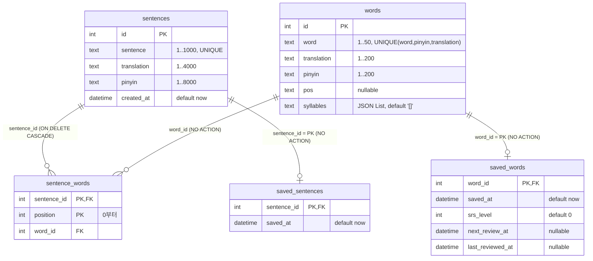

# Table (drift 로컬 DB)

> 2026-11-19 정리 반영
> - 이름·위치: `lib/table/` → `lib/database/`(DB 정의) + `lib/database/tables/`(테이블 정의)로 이동, `saved_word.dart`/`saved_sentence.dart` → `saved_words_table.dart`/`saved_sentences_table.dart`
> - 스키마 v5: `sentence_words.position` 추가, PK `{sentenceId, wordId}` → `{sentenceId, position}` (같은 단어 반복·순서 보장)
> - 스키마 v6: `sentences.sentence` 유니크 인덱스(같은 문장 = 원문이 같은 문장), 기존 중복 행 병합
> - 스키마 v7: 옛 버전에서 깨진 채 저장된 `words.syllables`를 `'[]'`로 지움
> - 길이 상한 재조정(앱 DB = 최후 방어선, 서버 검증 ≤ 앱 상한), `words.syllables`를 `TypeConverter`(`List<Syllable>`)로 노출

앱의 로컬 저장소는 [drift](https://drift.simonbinder.eu/)(SQLite ORM)로 만들었습니다. 이 문서는 `lib/database/` 아래의 테이블 정의, `AppDatabase` 설정, 코드 생성 방법, 스키마를 바꿀 때의 절차를 정리합니다.

관련 문서:
- 테이블을 읽고 쓰는 코드: [repository.md](./repository.md)
- 서버 응답 모델(`SentenceAnalysis`, `WordAnalysis` 등)과 drift 행 클래스의 차이: [model.md](./model.md)
- `dbProvider`와 Riverpod 주입 구조: [provider.md](./provider.md)
- 화면 라우팅: [router.md](./router.md)

---

## 1. 파일 구성

| 파일 | 내용 |
|---|---|
| `lib/database/tables/words_table.dart` | `Words` 테이블 (단어) |
| `lib/database/tables/sentences_table.dart` | `Sentences` 테이블 (문장) |
| `lib/database/tables/sentence_words_table.dart` | `SentenceWords` 테이블 (문장-단어 매핑) |
| `lib/database/tables/saved_words_table.dart` | `SavedWords` 테이블 (사용자가 저장한 단어 + 복습(SRS) 정보) |
| `lib/database/tables/saved_sentences_table.dart` | `SavedSentences` 테이블 (사용자가 저장한 문장) |
| `lib/database/converters/syllables_converter.dart` | `SyllablesConverter`: `words.syllables` JSON TEXT ↔ `List<Syllable>` |
| `lib/database/database.dart` | `AppDatabase`: 테이블 등록, 스키마 버전, 마이그레이션, 연결 설정 |
| `lib/database/database.g.dart` | `build_runner`가 생성하는 파일. **직접 수정하지 않습니다** |
| `lib/provider/db_provider.dart` | `AppDatabase` 하나를 앱 전체에 제공하는 Riverpod `Provider` |

폴더를 나눈 이유: `database.dart`는 테이블이 아니라 DB 전체 정의(등록·버전·마이그레이션·연결)라서 `table/` 폴더에 있으면 역할이 헷갈립니다. 테이블 파일은 모두 `<SQL 테이블 이름>_table.dart` 형식입니다.

drift 클래스 이름과 실제 SQL 테이블 이름은 다릅니다. drift는 클래스 이름을 snake_case로 바꿔 테이블 이름으로 씁니다(`SentenceWords` → `sentence_words`). 행(row) 클래스 이름은 복수형에서 s를 뗀 이름으로 생성됩니다(`Words` → `Word`, `Sentences` → `Sentence`, `SavedWords` → `SavedWord`).

---

## 2. 테이블별 상세

표기: "길이"는 drift `withLength(min, max)`입니다. NOT NULL은 drift 기본값이고 `nullable()`인 컬럼만 NULL을 허용합니다.

**길이 상한의 역할.** 앱 DB는 최후 방어선입니다. 1차 검증은 서버가 LLM 출력에 대해 하고(`pass_kuai_server/src/analyze/analyze-result.validator.ts`, [model.md](./model.md) 1-3절), 서버 상한은 앱 상한과 **같거나 더 엄격**하게 맞춰져 있습니다. `withLength`는 SQL 제약이 아니라 drift가 insert 전에 Dart 쪽에서 검사하는 것이라(생성 SQL에 CHECK 없음) 숫자를 바꿔도 마이그레이션은 필요 없고 codegen만 하면 됩니다. 위반하면 `InvalidDataException`이 나고, 저장 버튼은 이를 "내용이 너무 길거나 비어 있어서 저장하지 못했어요."로 보여 줍니다(`lib/api/save_error.dart`).

### 2.1 `words` (`Words`)

| 컬럼 | drift 타입 | 길이 | nullable | 기본값 | 비고 |
|---|---|---|---|---|---|
| `id` | `IntColumn` | | X | autoIncrement | **PK** |
| `word` | `TextColumn` | 1~50 | X | | 한자 |
| `translation` | `TextColumn` | 1~200 | X | | 뜻 |
| `pinyin` | `TextColumn` | 1~200 | X | | |
| `pos` | `TextColumn` | 없음 | **O** | | 품사. v3에서 추가 |
| `syllables` | `TextColumn` + `SyllablesConverter` | 없음 | X | `'[]'` | SQL에서는 음절 목록 **JSON 문자열**, Dart에서는 `List<Syllable>`. v2에서 추가 |

- 기본키: `id`
- 유니크 키: `{word, pinyin, translation}` 조합. 같은 한자라도 병음이나 뜻이 다르면 다른 단어입니다(테스트 `行 xíng / háng` 참고).
- 외래키: 없음
- `syllables`는 `SyllablesConverter`가 읽고 쓸 때 자동으로 JSON 변환합니다. 코드에서는 `word.syllables`가 바로 `List<Syllable>`입니다. 깨진 JSON을 읽으면 로그를 남기고 debug 빌드에서는 assert, release에서는 빈 리스트입니다([model.md](./model.md) 3절).
- `WordRepository.insertIfAbsent`는 insert 전에 같은 `(word, pinyin, translation)`이 있는지 먼저 조회하고, 있으면 그 행의 `id`를 돌려줍니다. 유니크 제약 위반 예외가 나기 전에 막는 구조입니다.

### 2.2 `sentences` (`Sentences`)

| 컬럼 | drift 타입 | 길이 | nullable | 기본값 | 비고 |
|---|---|---|---|---|---|
| `id` | `IntColumn` | | X | autoIncrement | **PK** |
| `sentence` | `TextColumn` | 1~1000 | X | | 원문 |
| `translation` | `TextColumn` | 1~4000 | X | | 번역 (서버 상한 4000) |
| `pinyin` | `TextColumn` | 1~8000 | X | | 문장 병음 = 단어 병음을 공백으로 join (`SentenceAnalysis.pinyin`) |
| `createdAt` (`created_at`) | `DateTimeColumn` | | X | `currentDateAndTime` | insert 시각 |

- 기본키: `id`
- 외래키: 없음
- 유니크: **`sentence` 원문에 유니크 인덱스** `sentences_sentence_unique` (v6, `@TableIndex`). "같은 문장 = 원문이 같은 문장"이고 처음 저장한 행(번역·병음·매핑)을 유지합니다. LLM은 같은 문장도 분석할 때마다 번역이 조금씩 달라서, 번역까지 기준에 넣으면 단어장에 같은 문장이 여러 번 쌓이기 때문입니다.
  - 테이블 제약(`uniqueKeys`)이 아니라 인덱스로 건 이유: SQLite는 기존 테이블에 제약을 추가할 수 없어 테이블을 다시 만들어야 하는데, `sentences`는 `saved_sentences`·`sentence_words`가 FK로 가리키고 있어 재생성 위험이 큽니다. 인덱스는 `CREATE UNIQUE INDEX` 한 번이면 되고 중복 방지 효과는 같습니다.
  - 원문 비교는 완전 일치라 공백·문장부호만 다른 원문은 다른 문장입니다.
- `SentenceService.createSentence`는 get-or-insert입니다. 같은 원문이 있으면 기존 id를 돌려주고 아무것도 쓰지 않습니다.

### 2.3 `sentence_words` (`SentenceWords`): 문장-단어 매핑

| 컬럼 | drift 타입 | nullable | 참조 | onDelete |
|---|---|---|---|---|
| `sentence_id` | `IntColumn` | X | `sentences(id)` | **CASCADE** |
| `word_id` | `IntColumn` | X | `words(id)` | 지정 안 함 (SQLite 기본 NO ACTION) |
| `position` | `IntColumn` | X | | 문장 안 단어 순서(0부터). v5에서 추가 |

- 기본키: `{sentenceId, position}` 복합키(v5). 한 문장의 각 자리에 단어 하나가 들어가고, **같은 `word_id`가 한 문장에 여러 번 나올 수 있습니다**(我爱我家의 我). v4까지는 `{sentenceId, wordId}`라서 이런 문장을 저장하면 PK 위반으로 실패했습니다.
- 조회는 `position` 오름차순이라 다시 열 때 원래 문장 순서가 유지됩니다.
- 문장 하나와 단어 여러 개를 잇는 다대다(N:M) 연결 테이블입니다.
- 생성 SQL: `REFERENCES sentences (id) ON DELETE CASCADE`, `REFERENCES words (id)`.
- 문장을 지우면 매핑은 자동으로 같이 지워집니다. 반대로 **매핑에 걸려 있는 단어는 지울 수 없습니다**(FK 위반).

### 2.4 `saved_words` (`SavedWords`): 저장한 단어 + SRS

| 컬럼 | drift 타입 | nullable | 기본값 | 참조 | 비고 |
|---|---|---|---|---|---|
| `word_id` | `IntColumn` | X | | `words(id)`, onDelete 지정 안 함 | **PK** |
| `saved_at` | `DateTimeColumn` | X | `currentDateAndTime` | | |
| `srs_level` | `IntColumn` | X | `0` | | v4에서 추가 |
| `next_review_at` | `DateTimeColumn` | **O** | | | v4에서 추가 |
| `last_reviewed_at` | `DateTimeColumn` | **O** | | | v4에서 추가 |

- 기본키가 `wordId` 하나라서 같은 단어를 두 번 저장할 수 없습니다(테스트 "중복은 막힌다").
- `words` 행을 가리키는 "북마크" 테이블입니다. 단어 내용은 `words`에 있고 여기에는 저장 시각과 복습 상태만 둡니다.

### 2.5 `saved_sentences` (`SavedSentences`)

| 컬럼 | drift 타입 | nullable | 기본값 | 참조 |
|---|---|---|---|---|
| `sentence_id` | `IntColumn` | X | | `sentences(id)`, onDelete 지정 안 함 |
| `saved_at` | `DateTimeColumn` | X | `currentDateAndTime` | |

- 기본키: `sentenceId`. 같은 문장 행은 한 번만 저장됩니다.
- onDelete를 지정하지 않았으므로 **저장된 문장의 `sentences` 행은 직접 지울 수 없습니다**(FK 위반 예외). 이 동작은 의도된 것이고 테스트로 확인합니다.

---

## 3. 관계도



---

## 4. 설계 의도: "검색 데이터"와 "저장 데이터"

`test/vocab_design_test.dart`에 설계 의도가 그대로 드러나 있습니다.

### 4.1 두 층으로 나눈 이유

- **검색 데이터**: `sentences`, `words`, `sentence_words`에 들어가는 문장·단어 원본(`SentenceService.createSentence`). 현재 코드에서는 분석만 해서는 DB에 쓰지 않고, **문장을 저장할 때** `saveSentence` → `createSentence`로 들어갑니다(분석 결과는 화면 state에만 있음). 단어장에서 저장을 해제하면 `saved_*` 행만 지워지고 원본은 남습니다.
- **저장 데이터**: 사용자가 저장하면 `saved_sentences` / `saved_words`에 해당 행의 id만 추가됩니다. 내용을 복사하지 않고 같은 행을 가리킵니다.

즉 `sentences`/`words`는 "캐시 + 원본", `saved_*`는 "이 행은 사용자가 지키고 싶다"는 표시입니다. 이 표시를 FK로 만들어 두었기 때문에 정리 작업이 저장본을 실수로 지우지 못합니다.

### 4.2 테스트로 확인하는 동작

| 테스트 | 확인하는 것 |
|---|---|
| FK가 켜져 있다 | `PRAGMA foreign_keys`가 1. 아래 cascade, FK 보호는 모두 이게 켜져 있어야 동작합니다 |
| 단어 저장: 중복은 막힌다 | `saveWord` 두 번째 호출은 `false`. `saved_words` PK가 `wordId` 하나라서 |
| 같은 한자 다른 뜻은 별도 단어 | `行(xíng, 가다)`와 `行(háng, 업종)`이 둘 다 저장됨. `words` 유니크 키가 `(word, pinyin, translation)` 조합이라서 |
| 문장 저장: 문장+단어+매핑 + 중복 방지 | `saveSentence` 한 번에 문장, 단어 2개, 매핑 2개가 생기고 두 번째 호출은 `false` |
| 같은 단어 반복·순서 (`test/sentence_words_order_test.dart`) | 我爱我家 저장 후 다시 읽으면 [我, 爱, 我, 家]. 상한까지 채운 값은 저장, 넘는 값은 `InvalidDataException`으로 전체 롤백 |
| 동시 저장·원문 기준 (`test/vocab_concurrency_test.dart`) | `saveSentence` 3번 동시 호출 → 문장 1행·저장 1행. 번역만 다른 재분석은 처음 것 유지. 같은 원문 직접 insert는 유니크 위반 |
| 마이그레이션 (`test/migration_test.dart`) | v4·v5·v6 스키마 SQL로 만든 DB를 현재 버전으로 올려 데이터 보존, position 채우기, 중복 병합, 스키마가 새 DB와 같은지, FK 무결성, 깨진 `syllables` 정리(정상 값·단어 행·단어장·매핑은 유지) 확인 |
| cleanup | 저장 안 한 문장(`再见`)과 그 단어(`再`, `见`)는 지워지고 저장한 문장(`你好`), 그 매핑과 단어는 남음 |
| 개별 저장한 단어는 cleanup에서 보호 | 어떤 문장에도 연결되지 않은 단어라도 `saved_words`에 있으면 남음 |
| cascade | 검색 문장을 지우면 `sentence_words` 매핑도 같이 사라짐 |
| 저장된 문장은 FK 보호로 직접 삭제되지 않음 | `saved_sentences`가 가리키는 문장을 `deleteSentence`로 지우면 예외 |

### 4.3 cleanup 동작 순서 (`SentenceService.cleanupSearchData`)

하나의 트랜잭션 안에서 다음 순서로 지웁니다.

1. `saved_sentences`에 없는 `sentences` 행 삭제 → cascade로 해당 `sentence_words` 매핑도 삭제
2. `sentence_words`에도 `saved_words`에도 없는 `words` 행 삭제

순서가 중요합니다. 1번에서 매핑이 먼저 사라져야 2번에서 "고아가 된 단어"가 생기고, `word_id`는 NO ACTION이라 매핑이 남아 있는 단어를 먼저 지우려 하면 FK 위반이 납니다.

> 메모: `cleanupSearchData`는 현재 `lib/` 어디에서도 호출되지 않고 테스트에서만 부릅니다. 언제 실행할지(앱 시작 시, 화면 이탈 시 등)는 아직 연결 전입니다.

---

## 5. AppDatabase (`lib/database/database.dart`)

### 5.1 테이블 등록

```dart
@DriftDatabase(
  tables: [Sentences, Words, SentenceWords, SavedWords, SavedSentences],
)
class AppDatabase extends _$AppDatabase { ... }
```

- 테이블 클래스를 새로 만들면 반드시 이 목록에 넣어야 `database.g.dart`에 코드가 생성됩니다.
- `_$AppDatabase`는 생성 파일에 있는 부모 클래스이고, `db.words`, `db.sentences` 같은 테이블 접근자를 제공합니다.
- 생성자는 `AppDatabase([QueryExecutor? executor])`입니다. 인자가 없으면 실제 파일 DB(`_openConnection()`)를 열고, 테스트에서는 `AppDatabase(NativeDatabase.memory())`로 메모리 DB를 넣습니다.

### 5.2 schemaVersion과 마이그레이션 이력

현재 `schemaVersion => 7`. `onCreate`는 따로 정의하지 않았으므로 drift 기본 동작(모든 테이블·인덱스 생성)을 씁니다. 새로 설치한 앱은 바로 v7 스키마로 만들어집니다.

`onUpgrade`는 `from` 기준으로 단계별로 누적 실행됩니다(예: v1 → v7이면 여섯 블록이 모두 실행).

| 버전 | 조건 | 변경 |
|---|---|---|
| v1 | | 최초 스키마 (마이그레이션 코드로 미루어 보면 `words`에 `syllables`, `pos`가 없고 `saved_words`에 SRS 컬럼이 없던 상태) |
| v2 | `from < 2` | `words.syllables` 추가 |
| v3 | `from < 3` | `words.pos` 추가 |
| v4 | `from < 4` | `saved_words.srs_level`, `next_review_at`, `last_reviewed_at` 추가 |
| v5 | `from < 5` | `sentence_words`에 `position` 추가 + PK를 `{sentence_id, position}`으로. PK는 `addColumn`으로 못 바꾸므로 `m.alterTable(TableMigration(...))`으로 테이블을 다시 만들어 옮김. 기존 행의 `position`은 같은 문장 안에서 들어간 순서(rowid 순)로 0부터 채움(`createSentence`가 단어 순서대로 insert했으므로 rowid 순 = 원래 순서) |
| v6 | `from < 6` | 원문이 같은 `sentences` 중복 행을 하나로 병합(`_mergeDuplicateSentences`) 후 유니크 인덱스 `sentences_sentence_unique` 생성. **트랜잭션 하나로 묶음**(drift는 `onUpgrade`를 트랜잭션으로 감싸지 않으므로, 중간에 실패하면 반쯤 지워진 상태가 남지 않게 함. 실패 시 user_version 5로 남아 다음 실행 때 다시 시도) |
| v7 | `from < 7` | `words.syllables` 중 `SyllablesConverter.isValid`로 해석되지 않는 값을 `'[]'`로 지움(`_clearBrokenSyllables`, 트랜잭션). **단어 행은 지우지 않음**: 행을 지우면 그 단어를 가리키는 `sentence_words`(저장 문장의 단어 순서)와 `saved_words`(단어장·복습 기록)까지 지워야 하는데, 깨진 건 성조 색칠용 음절뿐이라 사용자 데이터 손실이 너무 큼. 지운 단어는 성조 색만 빠짐. 지금은 쓰기가 `toSql` 하나뿐이라 새로 깨질 일은 없음 |

**v6 병합 규칙** (`lib/database/database.dart` `_mergeDuplicateSentences`)
1. 남길 행: 같은 원문 그룹에서 `saved_sentences`에 있는 행 중 가장 작은 id, 저장된 행이 없으면 그룹에서 가장 작은 id
2. `saved_sentences`: 남길 행의 `saved_at`을 그룹 저장 기록의 최솟값으로 당기고, 지워질 행의 저장 기록은 삭제
3. `sentence_words`: 지워질 행의 매핑은 버림(남길 행의 매핑 유지)
4. 자식(`saved_sentences`, `sentence_words`)을 먼저 지우고 `sentences`를 마지막에 지움(`saved_sentences` → `sentences` FK에 cascade가 없기 때문)
5. `words`는 건드리지 않음. 매핑을 잃은 고아 단어는 `cleanupSearchData`가 정리

지워지는 중복 행의 번역·매핑은 영구히 사라집니다(합의한 규칙: 처음 저장한 것 유지).

`addColumn`으로 NOT NULL 컬럼을 추가할 수 있는 건 기본값이 있기 때문입니다(`syllables` 기본 `'[]'`, `srs_level` 기본 `0`). 나머지(`pos`, `next_review_at`, `last_reviewed_at`)는 nullable입니다. `position`은 기본값이 없어서 `alterTable`의 `columnTransformer`로 값을 계산해 채웁니다.

마이그레이션 테스트(`test/migration_test.dart`)는 옛 버전의 `CREATE TABLE` SQL과 `PRAGMA user_version`으로 메모리 DB를 만든 뒤 `AppDatabase`로 열어 업그레이드합니다. 새 버전을 추가할 때 같은 방식으로 케이스를 추가하세요.

### 5.3 beforeOpen: 외래키 켜기

```dart
beforeOpen: (details) async {
  await customStatement('PRAGMA foreign_keys = ON');
},
```

SQLite는 기본적으로 외래키 검사를 **끈 상태**로 연결을 엽니다. 이 줄이 없으면 `references(...)`와 `onDelete: KeyAction.cascade`가 SQL에 적혀 있어도 아무 효과가 없습니다. cascade와 FK 보호가 모두 이 설정에 의존하므로 테스트 첫 항목으로 확인합니다.

### 5.4 DB 파일 이름과 위치

```dart
driftDatabase(
  name: 'passKuai',
  native: const DriftNativeOptions(
    databaseDirectory: getApplicationSupportDirectory,
  ),
);
```

- `drift_flutter`는 `name`에 `.sqlite`를 붙여 파일을 만듭니다 → **`passKuai.sqlite`**.
- 위치는 `path_provider`의 `getApplicationSupportDirectory()`입니다(앱 지원 디렉터리. 사용자 문서 폴더가 아님).
- `dbProvider`(`lib/provider/db_provider.dart`)가 `AppDatabase()`를 한 번 만들어 공유합니다. 스플래시 화면이 `SELECT 1`로 미리 연결을 열어 둡니다(warm-up). 자세한 내용은 [provider.md](./provider.md).

---

## 6. 코드 생성 (`database.g.dart`)

### 6.1 무엇이 생성되나

`database.dart`의 `part 'database.g.dart';`가 가리키는 파일로, `drift_dev`가 테이블 정의를 읽어 만듭니다. 약 3,400줄이며 주요 내용은 다음과 같습니다.

- `$WordsTable`, `$SentencesTable` 등: 컬럼 정의, 길이 검사(`GeneratedColumn.checkTextLength`), `REFERENCES` 문구
- 행 클래스 `Word`, `Sentence`, `SentenceWord`, `SavedWord`, `SavedSentence`
- insert/update용 `WordsCompanion` 등 Companion 클래스 (`Value(...)`로 값을 감싸서 씀)
- `_$AppDatabase`, `allSchemaEntities`(테이블 + 인덱스 `sentencesSentenceUnique`), cascade를 drift 스트림에 알리는 `WritePropagation`(`sentences` 삭제 → `sentence_words` 갱신 알림)
- `$AppDatabaseManager` 등 manager API

테이블 파일을 고치고 코드 생성을 돌리지 않으면 `.g.dart`가 옛 정의로 남아 컴파일 에러가 나거나, 더 나쁘게는 조용히 옛 스키마로 동작합니다.

### 6.2 실행 명령

```bash
# 한 번 생성
dart run build_runner build --delete-conflicting-outputs

# 파일 저장할 때마다 자동 생성
dart run build_runner watch --delete-conflicting-outputs
```

### 6.3 버전과 `dependency_overrides`

`pubspec.yaml` / `pubspec.lock` 기준:

| 패키지 | 선언 | 잠긴 버전 |
|---|---|---|
| `drift` | `^2.33.0` | 2.33.0 |
| `drift_flutter` | `^0.3.0` | 0.3.0 |
| `drift_dev` (dev) | `^2.33.0` | 2.33.0 |
| `build_runner` (dev) | `^2.15.0` | 2.15.0 |
| `sqlite3` | override `3.2.0` | 3.2.0 (direct overridden) |

```yaml
# build_runner가 native-assets 훅(sqlite3 3.3.2+)을 못 다뤄서 codegen 시 잠깐 고정
dependency_overrides:
  sqlite3: 3.2.0
```

주석의 의미: `sqlite3` 3.3.2 이상은 native-assets 빌드 훅을 쓰는데 `build_runner`가 이를 처리하지 못해 코드 생성이 실패했습니다. 그래서 `sqlite3`를 3.2.0으로 고정해 두었습니다. 주석에 "잠깐"이라고 적혀 있듯 임시 조치이고, `build_runner`가 이 훅을 지원하게 되면 override를 빼도 되는지 다시 확인해야 합니다. override를 지울 때는 코드 생성과 앱 실행(실기기 DB 열기)을 둘 다 확인하세요.

---

## 7. 테이블을 바꿀 때 체크리스트

컬럼 추가를 예로 듭니다.

1. **테이블 파일 수정**: 예) `lib/database/tables/words_table.dart`에 컬럼 추가. 새 테이블이면 `lib/database/tables/<테이블>_table.dart`로 만듭니다.
   - 이미 데이터가 있는 테이블에 NOT NULL 컬럼을 추가하려면 `withDefault(...)`가 있어야 합니다. 없으면 `nullable()`로 만드세요.
2. **새 테이블이면** `@DriftDatabase(tables: [...])`에 등록.
3. **`schemaVersion` 1 올리기**: 7 → 8.
4. **`onUpgrade`에 블록 추가**: 기존 블록은 그대로 두고 아래에 이어 붙입니다.
   ```dart
   if (from < 8) {
     await m.addColumn(words, words.newColumn);
     // 새 테이블이면: await m.createTable(newTable);
   }
   ```
   - 기존 블록을 지우거나 고치면 오래된 버전에서 올라오는 사용자의 DB가 깨집니다.
   - 컬럼 이름 바꾸기, 타입 바꾸기, 제약(PK, FK, onDelete) 바꾸기는 `addColumn`으로 안 됩니다. drift의 `TableMigration`(`m.alterTable(...)`)으로 테이블을 다시 만들어야 합니다(v5 참고). 유니크만 추가할 거면 유니크 인덱스가 더 간단합니다(v6 참고).
   - 여러 단계로 데이터를 고치는 블록은 `transaction`으로 묶으세요(v6 참고).
5. **코드 생성**: `dart run build_runner build --delete-conflicting-outputs`. (v5·v6 작업 때 sqlite3 3.2.0 고정 상태로 정상 동작 확인)
6. **사용처 수정**: Companion 생성과 모델 변환은 `lib/mapper/`, 쿼리는 `lib/repository/`([repository.md](./repository.md), [model.md](./model.md)).
7. **테스트**: `flutter test`. 일반 테스트의 메모리 DB는 항상 `onCreate`로 새로 만들어지므로 마이그레이션 경로는 `test/migration_test.dart`에서 따로 검증합니다(옛 버전 SQL로 DB를 만들어 업그레이드). 가능하면 이전 버전 앱이 설치된 기기/시뮬레이터에 새 빌드를 덮어 설치해서도 확인하세요.

---

## 8. 주의점 / 헷갈리는 부분 (메모만, 수정하지 않음)

- **DB 이름 `passQuai` → `passKuai`**: 현재 코드는 `name: 'passKuai'`입니다. git 초기 커밋(`707a96b`)의 `lib/table/database.dart`(현재 `lib/database/database.dart`)는 `name: 'passQuai'`였고, PR #1에서 바뀌었습니다. 그래서 예전 빌드를 설치한 기기는 이름이 바뀐 순간 **다른 파일**을 열게 되어, 기존 사용자 데이터는 새 DB로 옮겨지지 않고 옛 파일은 디스크에 남습니다. `onUpgrade`는 같은 파일 안에서만 동작하므로 이 경우를 처리하지 않습니다. 배포된 적이 있다면 옛 파일 이전 처리가 필요한지 검토 대상입니다.
- **길이 제한과 서버 제한의 관계**
  - `sentences.sentence` 최대 1000자는 서버 `MAX_SENTENCE_LENGTH = 1000`(`pass_kuai_server/src/analyze/dtos/analyze.sentence.request.dto.ts`), 앱 입력창 `_maxInputLength = 1000`(`analyze_home_screen.dart`)과 같은 값입니다. 세 곳이 따로 정의돼 있어 하나만 바꾸면 어긋납니다.
  - (정리됨) 예전에는 서버가 LLM 출력 길이를 검사하지 않아 앱 DB 상한(당시 단어 뜻 100자 등)을 넘는 응답이 오면 저장 전체가 실패했습니다. 지금은 서버가 같은 상한 이하로 검증해 422로 막고, 앱 상한은 최후 방어선입니다. 서버 `/analyze/word` 요청 DTO의 100자 제한은 앱이 쓰지 않는 lookup API라 저장과 무관합니다.
  - drift의 `withLength`는 생성 코드에서 `checkTextLength`(insert 시 Dart 쪽 검증)로 들어갑니다. 제한을 넘으면 drift 예외가 납니다.
- **FK 방향 정리**: cascade는 `sentence_words.sentence_id` 하나뿐입니다. `sentence_words.word_id`, `saved_words.word_id`, `saved_sentences.sentence_id`는 onDelete 미지정(NO ACTION)이라 참조된 행을 지우면 예외가 납니다. 저장본 보호는 이 예외를 이용한 것이므로 "에러가 나서 cascade로 바꾸자"고 하면 설계 의도가 깨집니다.
- **`PRAGMA foreign_keys = ON`을 지우면** cascade도 보호도 모두 사라집니다. 에러는 나지 않고 데이터만 조용히 어긋납니다.
- ~~`sentences`에는 유니크 키가 없습니다~~ (정리됨): v6에서 원문 유니크 인덱스. `createSentence`는 get-or-insert, `saveSentence`는 트랜잭션 하나로 `findIdBySentence` → `createSentence` → `save`. 자세한 내용은 [repository.md](./repository.md).
- **`syllables`는 SQL에서는 JSON 문자열**입니다. `SyllablesConverter`가 변환을 한 곳에서 맡고, 스키마 수준 검증은 없습니다. 옛 버전에서 깨진 값은 v7 마이그레이션이 지웠습니다. 그 뒤에도 깨진 값이 생기면(버그, 직접 DB 수정) debug 빌드에서는 assert로 그 행을 읽는 쿼리 전체가 실패해 바로 드러나고, release에서는 빈 리스트로 넘어갑니다.
- **PLAN.md와 실제 스키마가 다릅니다.** `docs/PLAN.md` 5장의 데이터 모델(`SavedWord.hanzi`, `initial/final/tone`, `isFavorite`, `SavedSentence.sourceImagePath`, `StudyLog`, "같은 hanzi 중복 방지")은 초기 계획이고, 실제 코드는 `words`/`sentences` + `saved_*` 참조 구조이며 중복 기준도 `(word, pinyin, translation)`입니다. 현재 기준은 코드입니다.
- **v5 position 채우기는 rowid 순서에 기댑니다.** 그 전에는 순서 정보 자체가 없었으므로 원래 insert 순서를 알 수 있는 유일한 근거입니다.
- **`dbProvider`는 DB를 닫지 않습니다**(`ref.onDispose` 없음). 앱 전체 수명 동안 하나를 쓰는 구조라 실사용엔 문제가 없지만, 테스트에서 provider로 DB를 만들면 직접 닫아야 합니다.
- ~~파일 이름 규칙이 섞여 있습니다~~ (2026-11-19 정리됨): 모든 테이블 파일이 `<테이블>_table.dart` 형식입니다.
